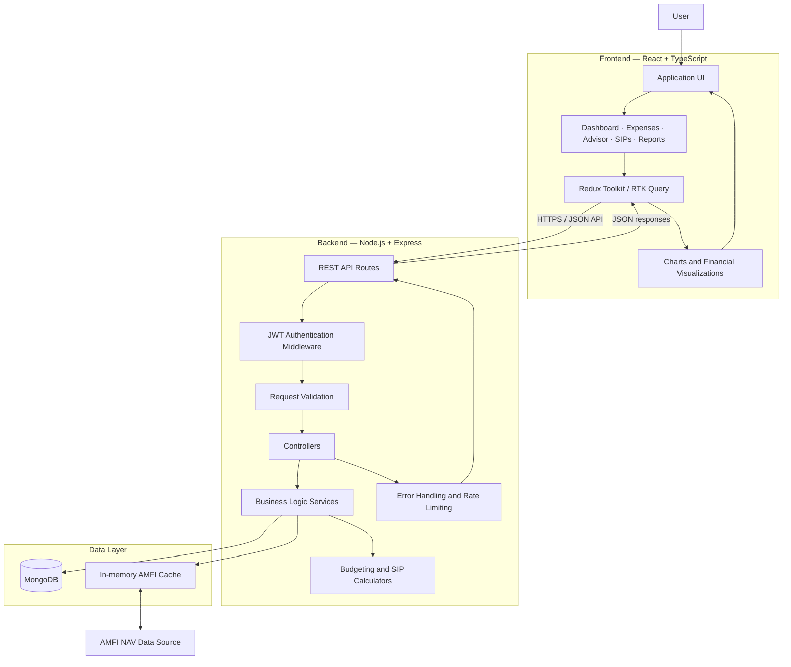
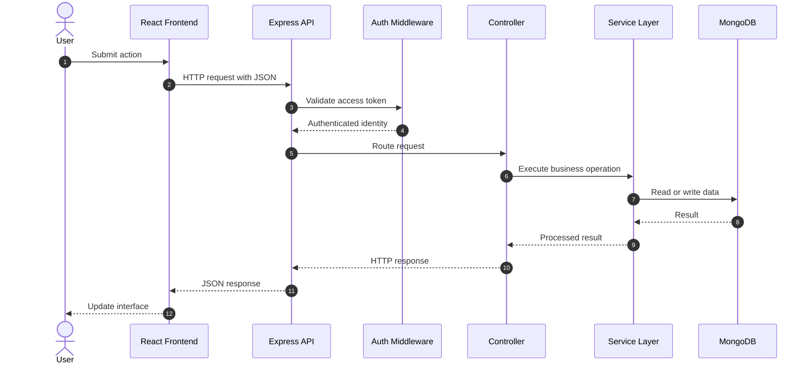
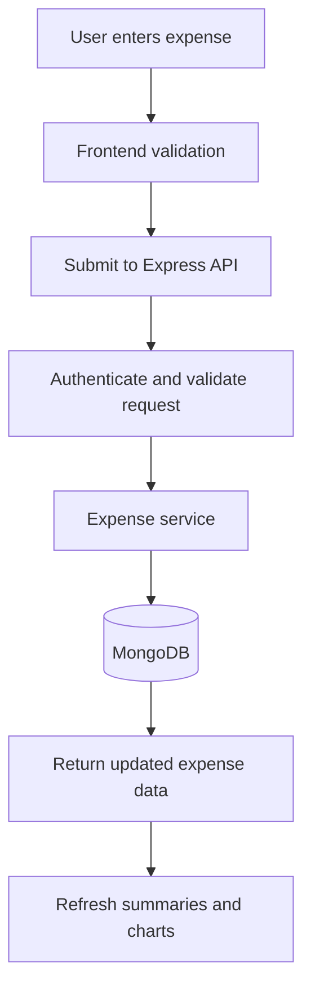
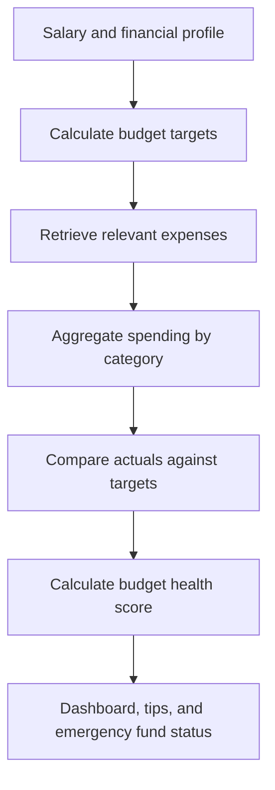
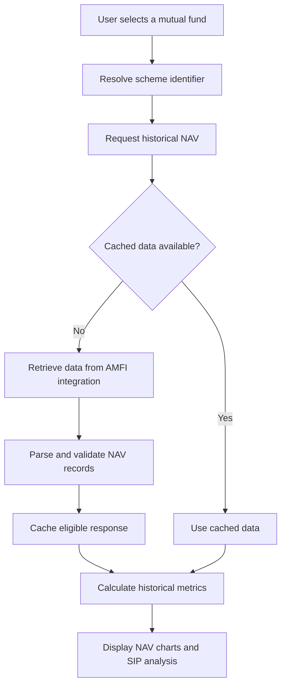

# Monetra — Smart Personal Finance & SIP Platform

**A rule-based personal finance platform for expense tracking, intelligent budgeting, emergency fund planning, and historical mutual fund analysis for Indian salaried professionals.**

<p align="center">
  <strong>React · TypeScript · Node.js · Express · MongoDB · AMFI</strong>
</p>

---

## Table of Contents

- [Overview](#overview)
- [Key Features](#key-features)
- [System Architecture](#system-architecture)
- [Application Workflows](#application-workflows)
- [Technology Stack](#technology-stack)
- [Project Structure](#project-structure)
- [Getting Started](#getting-started)
- [Environment Configuration](#environment-configuration)
- [API Reference](#api-reference)
- [Financial Calculation Engine](#financial-calculation-engine)
- [Security](#security)
- [Development and Testing](#development-and-testing)
- [Troubleshooting](#troubleshooting)
- [Disclaimer](#disclaimer)
- [License](#license)

---

## Overview

**Monetra** is a full-stack personal finance application designed to help Indian salaried professionals understand their spending, maintain financial discipline, and explore long-term investment scenarios.

The platform combines expense management, deterministic financial calculations, budget health analysis, emergency fund tracking, and historical mutual fund NAV data in a single application.

Rather than relying on a generative AI model for financial calculations, Monetra uses a rule-based financial engine to produce reproducible budget allocations and calculations. Its mutual fund module retrieves historical NAV data through AMFI integration, subject to source availability.

### The problem

Managing personal finances often involves disconnected tools for expense tracking, budgeting, saving, and investment research. This makes it difficult to understand spending patterns and evaluate financial decisions in one place.

### The solution

Monetra provides a unified workflow:

1. Record and categorize daily expenses.
2. Compare spending against salary-based budget targets.
3. Monitor savings and emergency fund progress.
4. Explore mutual fund NAV history and historical SIP performance.
5. Generate monthly financial reports for review.

## Key Features

### 1. Expense Management

- Record expenses with amounts, dates, categories, payment modes, and merchant details.
- Categorize transactions across common spending categories.
- Track recurring expenses such as rent, subscriptions, and utility bills.
- Filter transactions by date range, category, and payment method.
- View monthly summaries and spending trends.
- Edit and delete expense records.

### 2. Rule-Based Financial Advisor

Monetra implements a configurable budgeting framework inspired by the 50/30/20 rule.

| Budget allocation | Target | Purpose |
|---|---:|---|
| Needs | 50% | Essential living expenses |
| Wants | 30% | Discretionary spending |
| Savings and investments | 20% | Savings, emergency reserves, and investing |

The application provides:

- Salary-specific budget allocation.
- Category-level spending limits.
- Budget health scoring.
- Spending-versus-target comparisons.
- Emergency fund tracking based on essential monthly expenses.
- Practical budgeting guidance for different income levels.

Budget percentages and category limits should be treated as configurable planning guidelines, not universal financial recommendations.

### 3. Mutual Fund and SIP Analysis

- Retrieve mutual fund NAV data through AMFI integration.
- Search schemes by fund house or scheme keyword.
- Explore historical NAV trends across supported periods.
- Review available mutual fund categories, including index, flexi-cap, mid-cap, small-cap, and ELSS.
- Backtest recurring SIP contributions against historical data.
- Simulate potential future wealth using configurable monthly contributions and investment horizons.

**Data distinction:** Historical NAV values are market data. Future wealth calculations are mathematical projections, not predictions or guaranteed returns. Availability depends on the underlying data source.

### 4. Monthly Financial Reports

- Summarize monthly income and expenditure information available to the application.
- Compare category spending with budget limits.
- Highlight categories that exceed configured targets.
- Generate printable or PDF-ready financial summaries.

### 5. Authentication and Account Management

- User registration and login.
- Password hashing.
- JWT-based authentication.
- Access and refresh token workflows.
- Protected profile and expense endpoints.
- Salary and investment-risk profile management.

---

## System Architecture

Monetra follows a modular client-server architecture. The React frontend communicates with an Express REST API, while MongoDB stores application data. The backend coordinates authentication, expense management, financial calculations, reporting, and external AMFI data retrieval.

### High-level architecture



### Architecture responsibilities

| Component | Responsibility |
|---|---|
| React frontend | User interface, navigation, forms, dashboards, and visualizations |
| Redux Toolkit / RTK Query | Client state management and API interaction |
| Express routes | REST endpoint registration and request routing |
| Authentication middleware | JWT validation and protected resource access |
| Controllers | HTTP request and response handling |
| Services | Expense operations, budgeting logic, reporting, and AMFI integration |
| Financial utilities | Budget allocations, emergency fund calculations, and SIP mathematics |
| MongoDB / Mongoose | Persistent application data and schema enforcement |
| AMFI integration | Retrieval and processing of mutual fund NAV information |
| In-memory cache | Reuse of eligible external data to reduce repeated requests |

### Backend request lifecycle



*This diagram illustrates the typical protected data-request path. Public authentication routes and external AMFI requests may follow different paths.*

---

## Application Workflows

### Expense tracking workflow



### Budget analysis workflow



### SIP analysis workflow



The actual request paths, cache policy, and supported AMFI response formats should match the implementation in the repository.

---

## Technology Stack

| Layer | Technologies |
|---|---|
| Frontend | React 18, TypeScript, Vite |
| Styling | Tailwind CSS |
| State management | Redux Toolkit, RTK Query |
| Charts | Chart.js |
| Icons | Lucide React |
| Backend runtime | Node.js |
| API framework | Express.js |
| Database | MongoDB |
| ODM | Mongoose |
| Authentication | JWT and bcrypt |
| External financial data | AMFI NAV integration |
| Development | npm, Git |

---

## Project Structure

```text
monetra/
├── backend/
│   ├── src/
│   │   ├── config/
│   │   │   ├── Database configuration
│   │   │   └── Application constants
│   │   ├── controllers/
│   │   │   └── HTTP request handlers
│   │   ├── middleware/
│   │   │   ├── Authentication
│   │   │   ├── Error handling
│   │   │   └── Rate limiting
│   │   ├── models/
│   │   │   └── Mongoose schemas
│   │   ├── routes/
│   │   │   └── REST endpoint definitions
│   │   ├── seeders/
│   │   │   └── Database initialization
│   │   ├── services/
│   │   │   └── Financial and AMFI services
│   │   ├── utils/
│   │   │   └── Financial and date utilities
│   │   └── app.js
│   ├── .env.example
│   └── package.json
├── frontend/
│   ├── src/
│   │   ├── components/
│   │   ├── pages/
│   │   ├── store/
│   │   ├── types/
│   │   ├── utils/
│   │   ├── App.tsx
│   │   └── main.tsx
│   ├── index.html
│   ├── vite.config.ts
│   └── package.json
├── README.md
├── LICENSE
└── .gitignore
```

*The tree above is a conceptual overview. Retain the actual filenames and directories present in your repository; the `.env.example` file is a recommended template if one does not already exist.*

---

## Getting Started

### Prerequisites

Install the following:

- Node.js 18 or later, subject to compatibility with the project's dependencies.
- npm 9 or later.
- MongoDB locally or a MongoDB Atlas connection string.
- Git.

Verify the installations:

```bash
node --version
npm --version
git --version
```

### 1. Clone the repository

```bash
git clone https://github.com/reddy895/Monetra.git
cd Monetra
```

### 2. Configure the backend

```bash
cd backend
npm install
```

Create a local `.env` file using the template below. Generate your own secrets and configure your MongoDB connection.

```env
PORT=5000
NODE_ENV=development

MONGODB_URI=mongodb://127.0.0.1:27017/monetra

JWT_SECRET=replace_with_a_long_random_secret
JWT_REFRESH_SECRET=replace_with_another_long_random_secret

JWT_EXPIRES_IN=15m
JWT_REFRESH_EXPIRES_IN=7d

FRONTEND_URL=http://localhost:3000
```

Use the exact environment variable names expected by the backend implementation.

Initialize the database if the repository includes the documented seeder:

```bash
node src/seeders/seed.js
```

Start the backend using the script defined in `backend/package.json`:

```bash
npm run dev
```

If the project does not define a `dev` script, use its documented startup command, such as:

```bash
node src/app.js
```

### 3. Configure the frontend

Open another terminal:

```bash
cd frontend
npm install
npm run dev
```

Vite normally uses port `5173` unless configured otherwise. Open the URL printed in the terminal.

Ensure the frontend's API base URL points to the backend at `http://localhost:5000` or the configured API address.

### 4. Verify the application

- Confirm MongoDB is reachable.
- Check backend startup logs.
- Open the frontend development URL.
- Register a test account.
- Add an expense and verify that it appears in the expense list.
- Check the budget dashboard.
- Test mutual fund search and NAV history when the external data source is available.

---

## API Reference

The following table summarizes the endpoints documented for the application. Exact request schemas, authentication requirements, pagination parameters, and response formats should be confirmed in the corresponding route and controller implementations.

### Authentication — `/api/auth`

| Method | Endpoint | Description |
|---|---|---|
| POST | `/api/auth/register` | Register an account |
| POST | `/api/auth/login` | Authenticate and issue tokens |
| POST | `/api/auth/refresh-token` | Refresh an access token |
| POST | `/api/auth/logout` | Log out and revoke a refresh token |
| GET | `/api/auth/profile` | Retrieve the current profile |
| PUT | `/api/auth/profile` | Update profile and financial preferences |

### Expenses — `/api/expenses`

| Method | Endpoint | Description |
|---|---|---|
| GET | `/api/expenses` | List expenses with available filters |
| POST | `/api/expenses` | Create an expense |
| GET | `/api/expenses/:id` | Retrieve an expense |
| PUT | `/api/expenses/:id` | Update an expense |
| DELETE | `/api/expenses/:id` | Delete an expense |
| GET | `/api/expenses/summary` | Retrieve spending summaries |
| GET | `/api/expenses/trend` | Retrieve spending trends |

### Financial Advisor — `/api/advisor`

| Method | Endpoint | Description |
|---|---|---|
| GET | `/api/advisor/dashboard` | Retrieve budget analysis and tips |
| GET | `/api/advisor/blueprint` | Retrieve budget allocations |
| GET | `/api/advisor/categories` | Compare category spending with limits |
| GET | `/api/advisor/emergency-fund` | Retrieve emergency fund status |
| GET | `/api/advisor/what-if` | Calculate supported what-if scenarios |
| GET | `/api/advisor/monthly-report` | Generate a monthly financial report |

### Mutual Funds and SIPs — `/api/sips`

| Method | Endpoint | Description |
|---|---|---|
| GET | `/api/sips/live-nav/:schemeCode` | Retrieve NAV history and supported metrics |
| GET | `/api/sips/search-live` | Search available mutual fund schemes |
| GET | `/api/sips/recommendations` | Retrieve configured fund recommendations |
| POST | `/api/sips/calculate` | Calculate investment scenarios |

### Example request

A protected endpoint may require an access token:

```http
GET /api/expenses
Authorization: Bearer <access_token>
```

Use the actual token format and request headers implemented by the backend. Never include real tokens in source control or public documentation.

---

## Financial Calculation Engine

Monetra separates financial calculations from presentation so that budget and investment logic can be maintained and tested independently.

### Budget allocation

For a monthly salary \(S\):

- Needs target = \(0.50 \times S\)
- Wants target = \(0.30 \times S\)
- Savings target = \(0.20 \times S\)

For example, at a monthly salary of ₹30,000:

| Allocation | Target amount |
|---|---:|
| Needs | ₹15,000 |
| Wants | ₹9,000 |
| Savings | ₹6,000 |

These targets provide a starting point for planning and do not account automatically for every person's obligations or circumstances.

### Emergency fund

A basic emergency fund target can be calculated as:

\[
\text{Target Fund} =
\text{Essential Monthly Expenses}
\times
\text{Target Months}
\]

For a target of three to six months, the target-month parameter can be set between 3 and 6.

### SIP compounding simulation

For a simplified recurring monthly investment with end-of-month contributions:

\[
FV = P \times \frac{(1+r)^n-1}{r}
\]

Where:

- \(FV\) is the future value.
- \(P\) is the monthly contribution.
- \(r\) is the assumed monthly rate of return.
- \(n\) is the total number of monthly contributions.

This formula is a simplified illustration. Actual historical SIP backtesting should use the relevant historical NAV observations and contribution dates. Any annual-to-monthly return conversion must be consistent with the selected calculation methodology.

---

## Security

Security is a core consideration because the application handles personal and financial information.

Recommended safeguards include:

- Hash passwords with an appropriate password-hashing algorithm and work factor.
- Store JWT secrets in environment variables rather than source code.
- Validate authentication and authorization on protected endpoints.
- Ensure users can access only their own financial records.
- Validate and sanitize request inputs.
- Apply rate limiting to sensitive endpoints.
- Avoid logging passwords, tokens, or secret values.
- Configure CORS for trusted frontend origins.
- Use HTTPS in production.
- Validate external financial data before processing it.
- Keep dependencies updated and review security advisories.

**Production checklist**

- [ ] Strong, unique JWT secrets configured.
- [ ] Refresh-token rotation and revocation verified.
- [ ] Per-user authorization tested for all data endpoints.
- [ ] Input validation and error handling reviewed.
- [ ] CORS and rate limiting configured.
- [ ] Environment files excluded from Git.
- [ ] Database credentials and network access secured.
- [ ] Logs reviewed for accidental sensitive-data exposure.

---

## Development and Testing

Run available tests using the scripts and test framework configured in each package.

For example:

```bash
cd backend
npm test
```

If the backend defines a lint script:

```bash
npm run lint
```

For the frontend, use the available scripts in `frontend/package.json`:

```bash
cd frontend
npm run build
```

These commands are examples and may need adjustment to match the actual package scripts.

Recommended test coverage includes:

- Authentication and token lifecycle.
- Expense CRUD operations and per-user data isolation.
- Budget calculations and category limits.
- Emergency fund calculations.
- SIP calculations using known input/output cases.
- Invalid request handling.
- AMFI integration failures and empty results.
- Frontend loading, error, and empty states.

---

## Troubleshooting

| Problem | What to check |
|---|---|
| Backend cannot connect to MongoDB | Verify MongoDB is running and `MONGODB_URI` is correct |
| Authentication fails | Check token expiration, signing secrets, and request headers |
| Frontend cannot reach the API | Verify the API base URL, backend port, and CORS configuration |
| Vite starts on another port | Open the URL printed in the terminal and check `vite.config.ts` |
| Seeder fails | Confirm database access and inspect the actual seeder path |
| NAV search fails | Check network connectivity, upstream availability, and response parsing |
| Charts have no data | Confirm API responses and historical data availability |
| Build or test commands fail | Inspect `package.json` scripts and dependency versions |

---

## Disclaimer

Monetra is a personal finance and investment analysis software project. Its budgeting rules, fund recommendations, historical performance displays, and future-value simulations are intended for informational and educational purposes.

- Historical performance does not guarantee future results.
- Investment values may fluctuate, and losses are possible.
- Simulated returns depend on assumptions and calculation methodology.
- Data availability and accuracy depend on the upstream source.
- The application should not be treated as a substitute for personalized financial, tax, or investment advice.

Verify financial information independently before making investment decisions.

---

## License

This project is licensed under the MIT License. See the [LICENSE](LICENSE) file for the full terms.

---

## Author

**Praveen Reddy**

GitHub: [@reddy895](https://github.com/reddy895)

Repository: [Monetra](https://github.com/reddy895/Monetra)

Built to make personal finance tracking, budgeting, and investment analysis more accessible through transparent calculations and a unified application.
